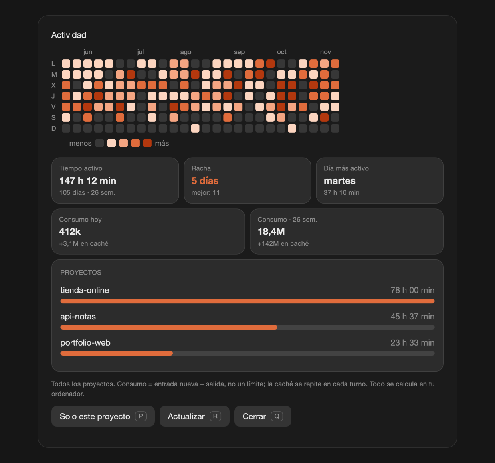
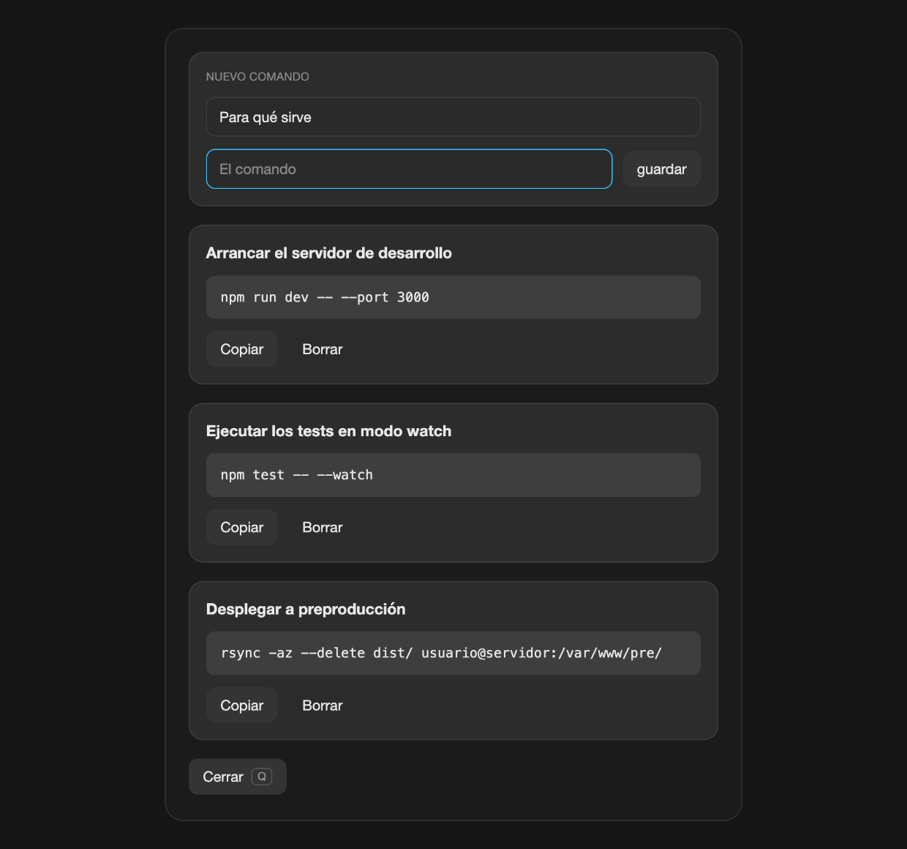
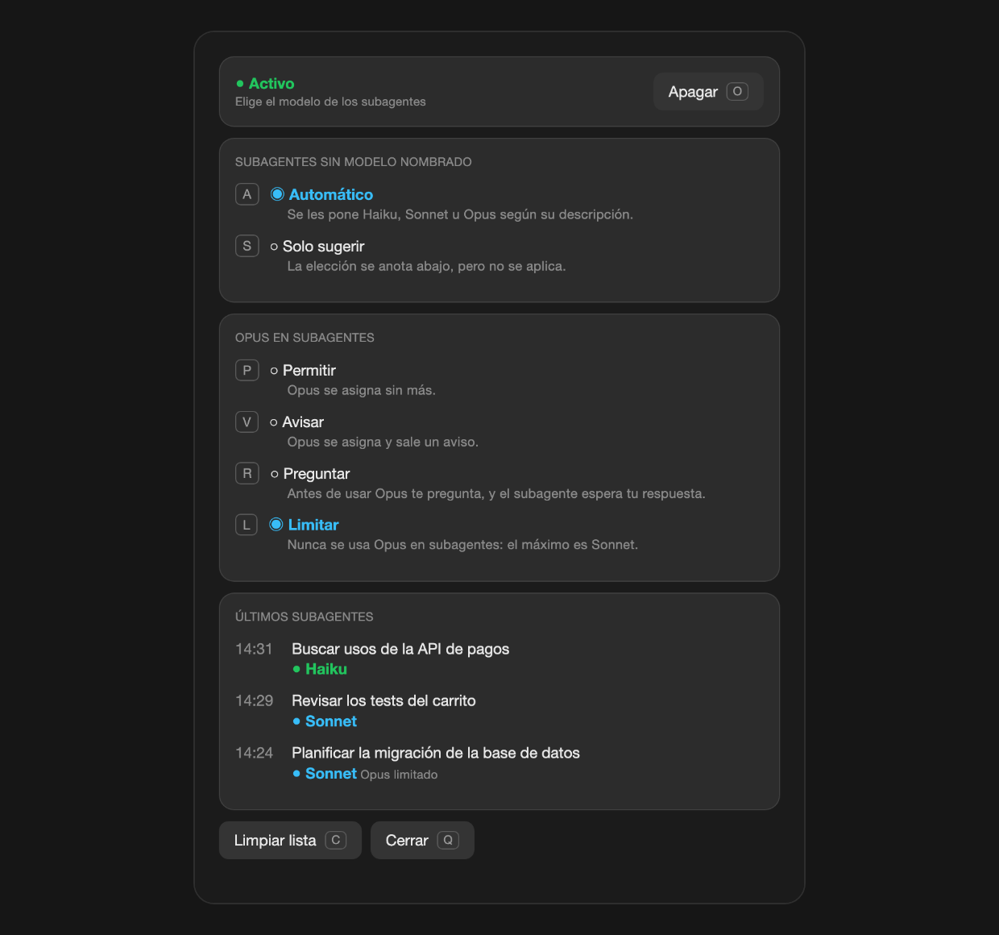
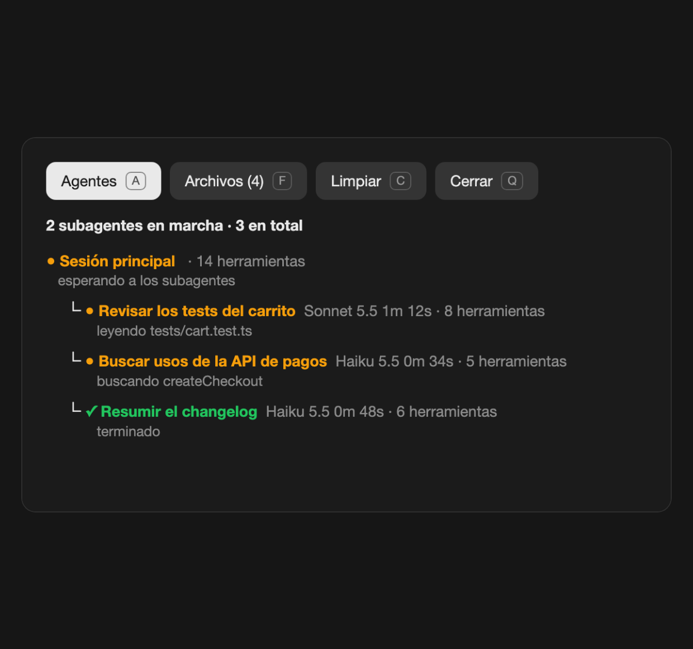
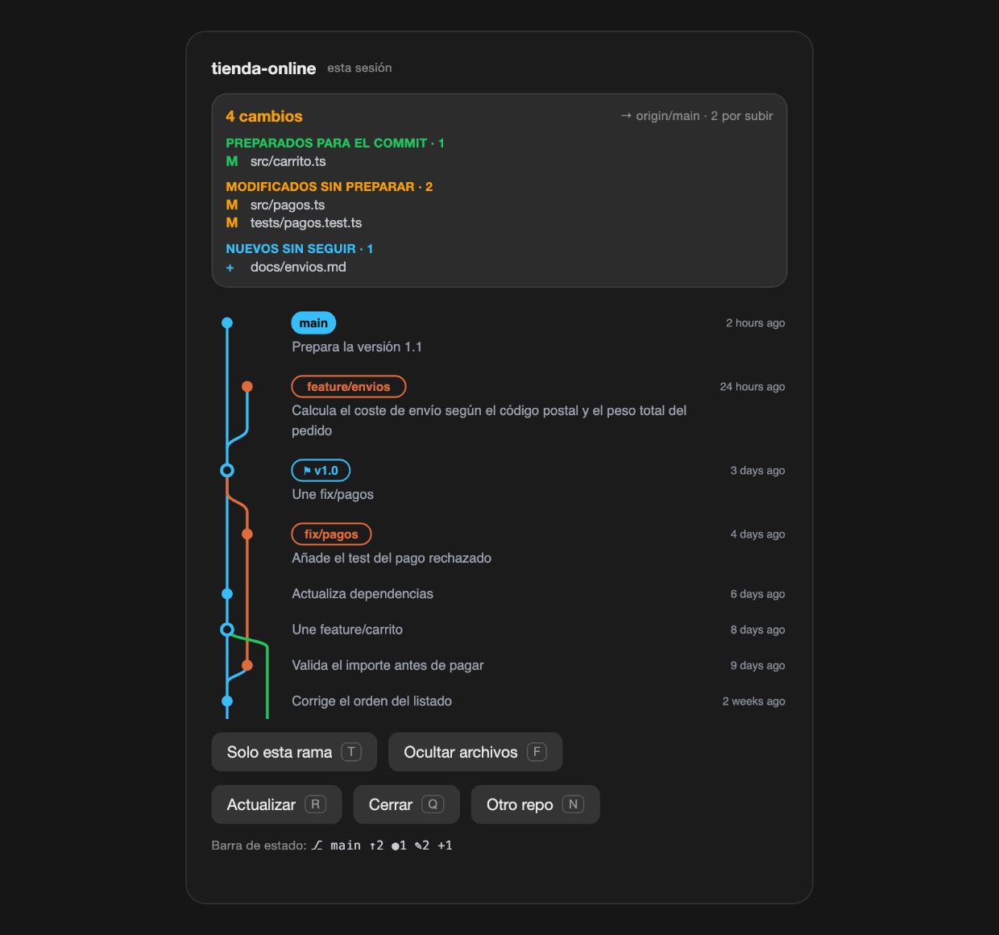
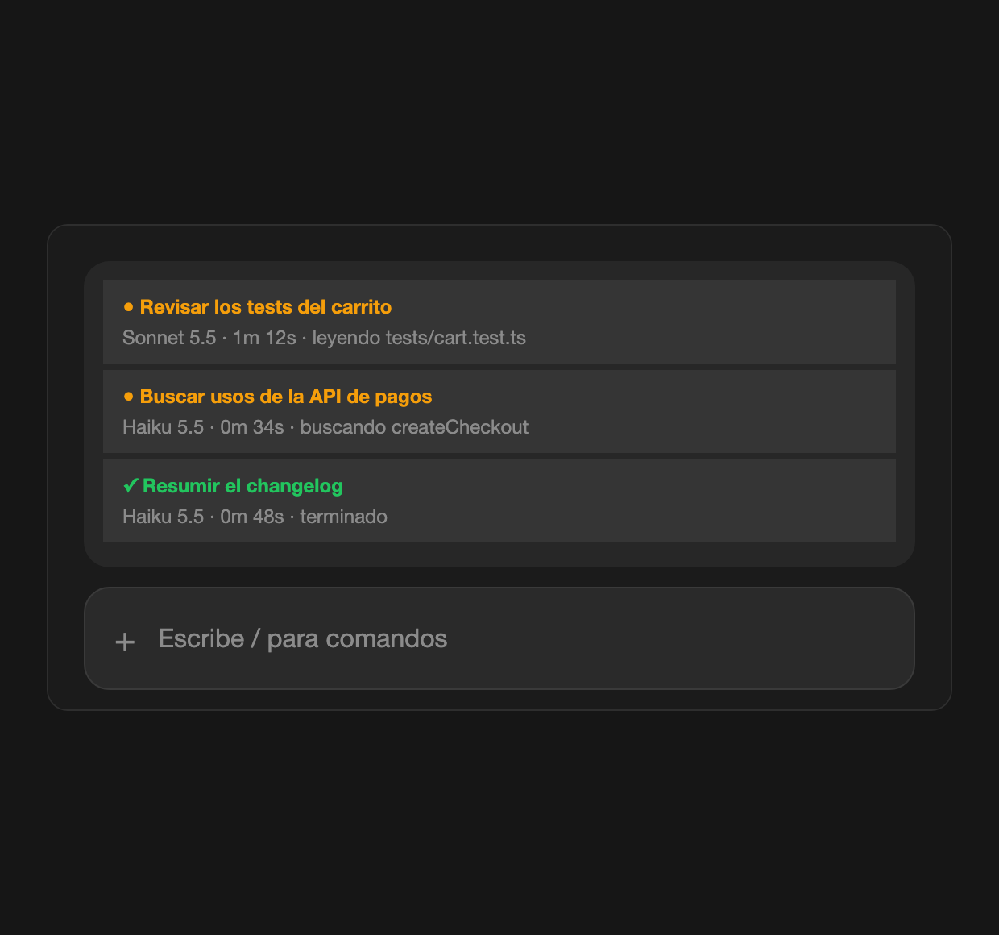

<h1 align="center">claude-mods</h1>
<p align="center"><b>Your usage, your subagents and your commands, in plain sight in Claude Code.</b><br>Seven small, independent plugins. Install only the ones you want.</p>

<p align="center"><a href="README.md">Español</a> | English</p>

<p align="center">
  <a href="LICENSE"></a>
  
  
</p>

<p align="center"></p>
<p align="center"><sub><b>prompt-band</b>: usage limits, context and shortcuts to the other panels. Screenshots use sample data, and the interface text is in Spanish.</sub></p>

## Install

Add the marketplace once, then install the mods you like:

```sh
claude plugin marketplace add daanidev21/claude-mods
claude plugin install prompt-band@claude-mods
```

To install them all:

```sh
for m in prompt-band heatmap agent-radar mission-control modelo-justo comandos ramas; do
  claude plugin install "$m@claude-mods"
done
```

On Windows (PowerShell):

```powershell
foreach ($m in "prompt-band","heatmap","agent-radar","mission-control","modelo-justo","comandos","ramas") {
  claude plugin install "$m@claude-mods"
}
```

It works on macOS and Windows. `heatmap` needs Python 3; details are in
[docs/install.en.md](docs/install.en.md).

Other ways to install, including trying a mod without installing it, are in
[docs/install.en.md](docs/install.en.md).

## The mods

<table>
  <tr>
    <td align="center" valign="top" width="50%"><a href="docs/mods.en.md#heatmap"></a><br><a href="docs/mods.en.md#heatmap"><b>heatmap</b></a><br>one square per day</td>
    <td align="center" valign="top" width="50%"><a href="docs/mods.en.md#comandos"></a><br><a href="docs/mods.en.md#comandos"><b>comandos</b></a><br>your project commands, one click away</td>
  </tr>
  <tr>
    <td align="center" valign="top" width="50%"><a href="docs/mods.en.md#modelo-justo"></a><br><a href="docs/mods.en.md#modelo-justo"><b>modelo-justo</b></a><br>the right model for each subagent</td>
    <td align="center" valign="top" width="50%"><a href="docs/mods.en.md#mission-control"></a><br><a href="docs/mods.en.md#mission-control"><b>mission-control</b></a><br>who spawned whom</td>
  </tr>
  <tr>
    <td align="center" valign="top" width="50%"><a href="docs/mods.en.md#ramas"></a><br><a href="docs/mods.en.md#ramas"><b>ramas</b></a><br>your repo's branch graph</td>
    <td align="center" valign="top" width="50%"><a href="docs/mods.en.md#agent-radar"></a><br><a href="docs/mods.en.md#agent-radar"><b>agent-radar</b></a><br>one line per subagent</td>
  </tr>
</table>

| Mod | What it does | Command |
| --- | --- | --- |
| [prompt-band](docs/mods.en.md#prompt-band) | 5h and 7d usage limits, context fill and shortcuts, in a row above the prompt | |
| [heatmap](docs/mods.en.md#heatmap) | One square per day of your time in Claude Code, with streak and time per project | `/heatmap` |
| [agent-radar](docs/mods.en.md#agent-radar) | One line for each running subagent | `/radar` |
| [mission-control](docs/mods.en.md#mission-control) | Who spawned whom, and which files each subagent touched | `/mission` |
| [modelo-justo](docs/mods.en.md#modelo-justo) | Picks Haiku, Sonnet or Opus for each subagent, with a policy for Opus | `/modelo-justo` |
| [comandos](docs/mods.en.md#comandos) | Per-project command notebook with a copy button | `/comandos` |
| [ramas](docs/mods.en.md#ramas) | Line graph of the repository's branches and commits | `/ramas` |

Each mod has its own README in `mods/<name>/` (`README.en.md` in English). The full
descriptions are in [docs/mods.en.md](docs/mods.en.md).

## Privacy

Everything runs on your machine. The only thing that leaves it is the
classification call made by `modelo-justo`, which uses your own session's client,
sends only the short description of each subagent, and can be turned off.
Details are in [its section](docs/mods.en.md#modelo-justo).

## Development

Each mod is a plugin with its own `.claude-plugin/plugin.json` and a module in
`hooks/`. To check one:

```sh
claude plugin validate mods/prompt-band
```

To try one without installing it:

```sh
git clone https://github.com/daanidev21/claude-mods && cd claude-mods
claude --plugin-dir mods/prompt-band
```

## License

[MIT](LICENSE)
