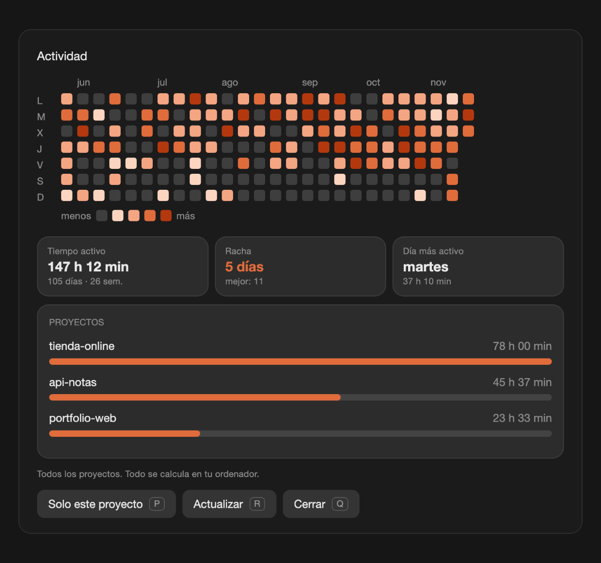
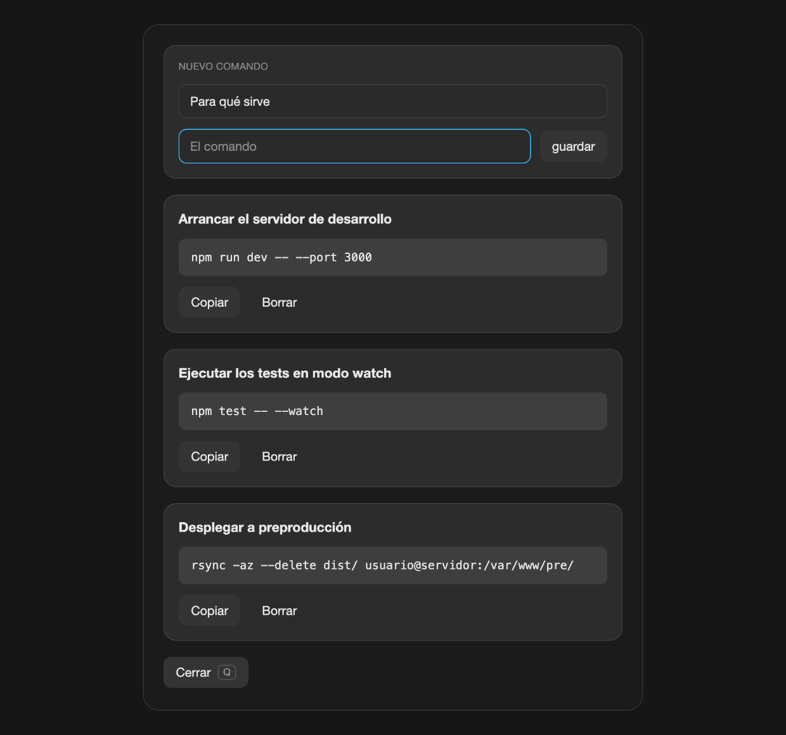
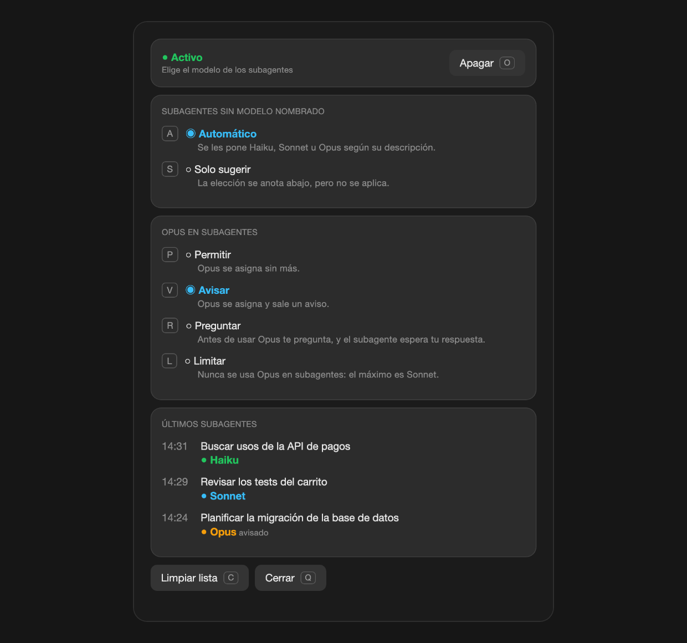
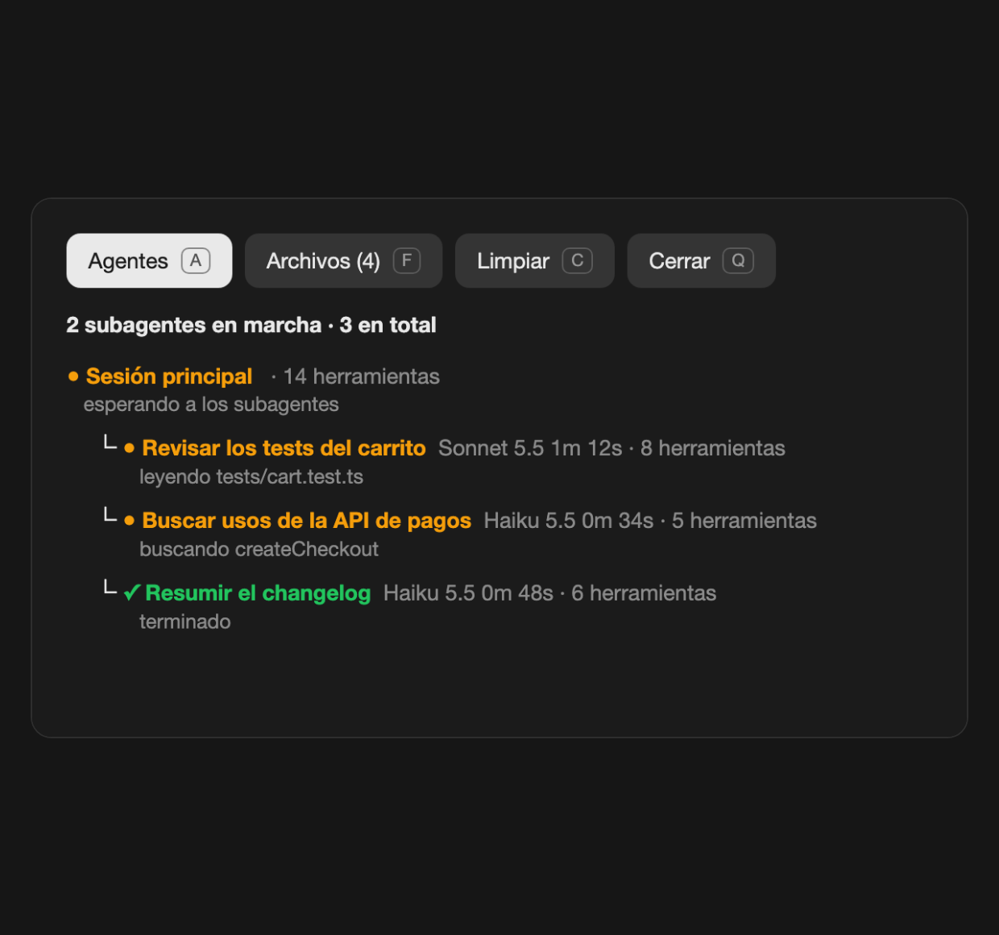
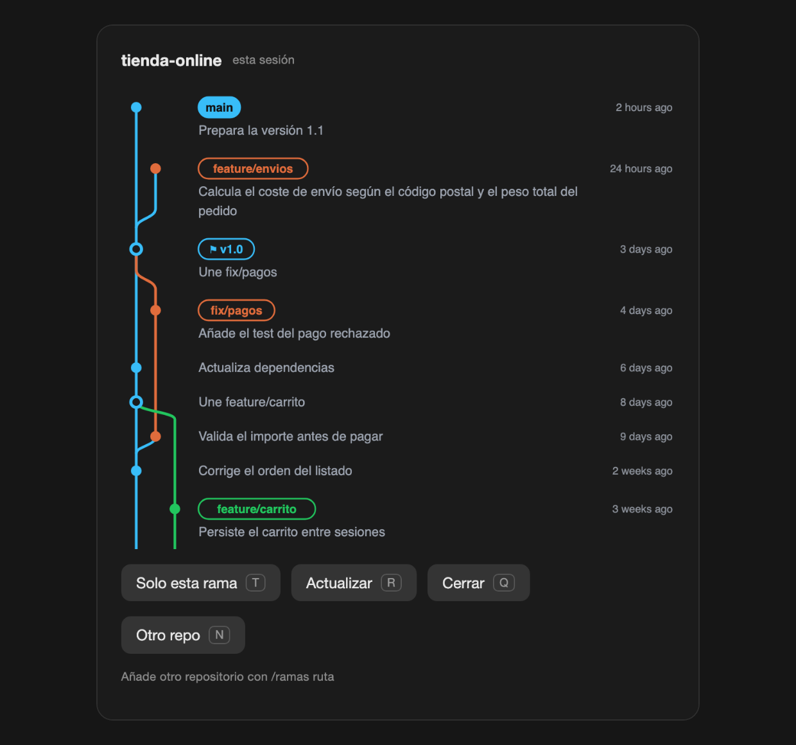
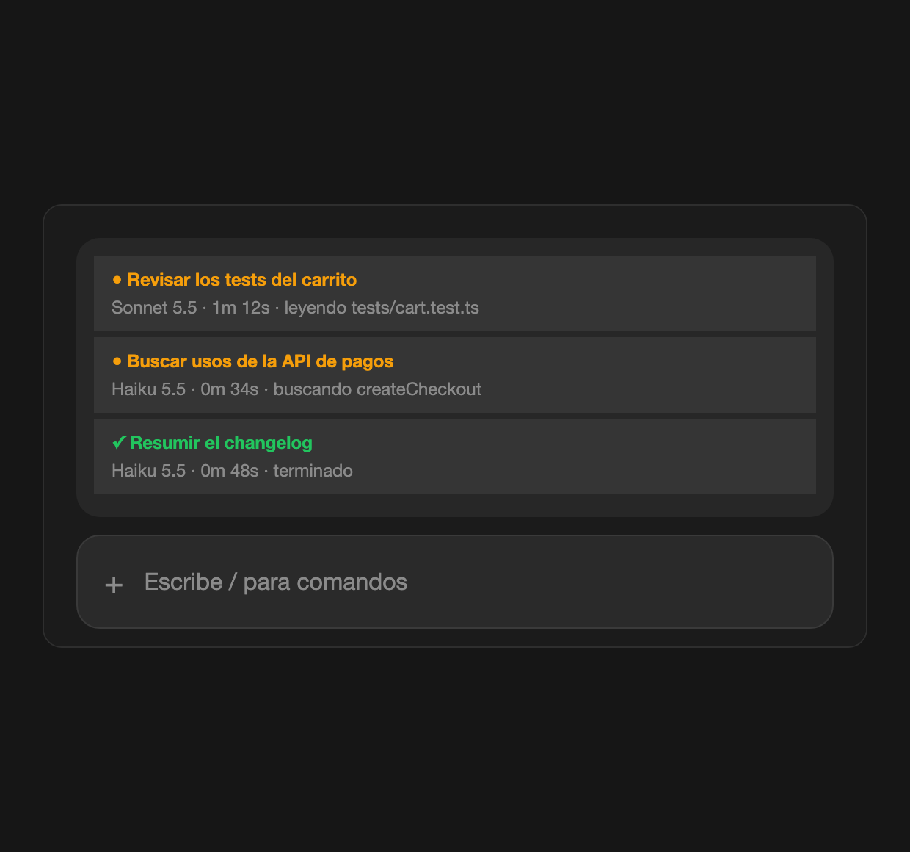

<h1 align="center">claude-mods</h1>
<p align="center"><b>Tu consumo, tus subagentes y tus comandos, a la vista en Claude Code.</b><br>Siete plugins pequeños e independientes. Instala solo los que quieras.</p>

<p align="center"><sub>Claude Code plugins: usage limits, subagent monitor, model picker, activity heatmap, git branch graph and saved commands. Everything runs locally.</sub></p>

<p align="center">Español | <a href="README.en.md">English</a></p>

<p align="center">
  <a href="LICENSE"></a>
  
  
</p>

<p align="center"></p>
<p align="center"><sub><b>prompt-band</b>: límites de uso, contexto y atajos a los demás paneles. Las imágenes usan datos de ejemplo.</sub></p>

## Instalación

Añade el marketplace una vez y luego instala los mods que te interesen:

```sh
claude plugin marketplace add daanidev21/claude-mods
claude plugin install prompt-band@claude-mods
```

Para instalarlos todos de una vez:

```sh
for m in prompt-band heatmap agent-radar mission-control modelo-justo comandos ramas; do
  claude plugin install "$m@claude-mods"
done
```

Otras formas de instalar, entre ellas probar un mod sin instalarlo, están en
[docs/install.md](docs/install.md).

## Los mods

<table>
  <tr>
    <td align="center" valign="top" width="50%"><a href="docs/mods.md#heatmap"></a><br><a href="docs/mods.md#heatmap"><b>heatmap</b></a><br>un cuadro por día</td>
    <td align="center" valign="top" width="50%"><a href="docs/mods.md#comandos"></a><br><a href="docs/mods.md#comandos"><b>comandos</b></a><br>tus comandos del proyecto, a un clic</td>
  </tr>
  <tr>
    <td align="center" valign="top" width="50%"><a href="docs/mods.md#modelo-justo"></a><br><a href="docs/mods.md#modelo-justo"><b>modelo-justo</b></a><br>el modelo de cada subagente</td>
    <td align="center" valign="top" width="50%"><a href="docs/mods.md#mission-control"></a><br><a href="docs/mods.md#mission-control"><b>mission-control</b></a><br>quién lanzó a quién</td>
  </tr>
  <tr>
    <td align="center" valign="top" width="50%"><a href="docs/mods.md#ramas"></a><br><a href="docs/mods.md#ramas"><b>ramas</b></a><br>el gráfico de ramas de tu repo</td>
    <td align="center" valign="top" width="50%"><a href="docs/mods.md#agent-radar"></a><br><a href="docs/mods.md#agent-radar"><b>agent-radar</b></a><br>una línea por subagente</td>
  </tr>
</table>

| Mod | Qué hace | Comando |
| --- | --- | --- |
| [prompt-band](docs/mods.md#prompt-band) | Límites de 5h y 7d, contexto y atajos, en una fila sobre el prompt | |
| [heatmap](docs/mods.md#heatmap) | Un cuadro por día con tu tiempo en Claude Code, racha y proyectos | `/heatmap` |
| [agent-radar](docs/mods.md#agent-radar) | Una línea por cada subagente en marcha | `/radar` |
| [mission-control](docs/mods.md#mission-control) | Quién lanzó a quién y qué archivos tocó | `/mission` |
| [modelo-justo](docs/mods.md#modelo-justo) | El modelo de cada subagente, con política para Opus | `/modelo-justo` |
| [comandos](docs/mods.md#comandos) | Bloc de notas de comandos por proyecto, con botón de copiar | `/comandos` |
| [ramas](docs/mods.md#ramas) | Gráfico de líneas con las ramas y commits del repositorio | `/ramas` |

La descripción completa de cada uno, con qué datos usa, está en
[docs/mods.md](docs/mods.md). Cada mod tiene su README en `mods/<nombre>/`, también en inglés (`README.en.md`).

## Privacidad

Todo se ejecuta en tu equipo. Lo único que sale de él es la llamada de
clasificación de `modelo-justo`, que usa el cliente de tu propia sesión, solo con
la descripción corta de cada subagente, y se puede apagar. El detalle de qué se
envía está en [su sección](docs/mods.md#modelo-justo).

## Desarrollo

Cada mod es un plugin con su `.claude-plugin/plugin.json` y un módulo en
`hooks/`. Para comprobar uno:

```sh
claude plugin validate mods/prompt-band
```

Para probarlo sin instalar:

```sh
git clone https://github.com/daanidev21/claude-mods && cd claude-mods
claude --plugin-dir mods/prompt-band
```

## Licencia

[MIT](LICENSE)
