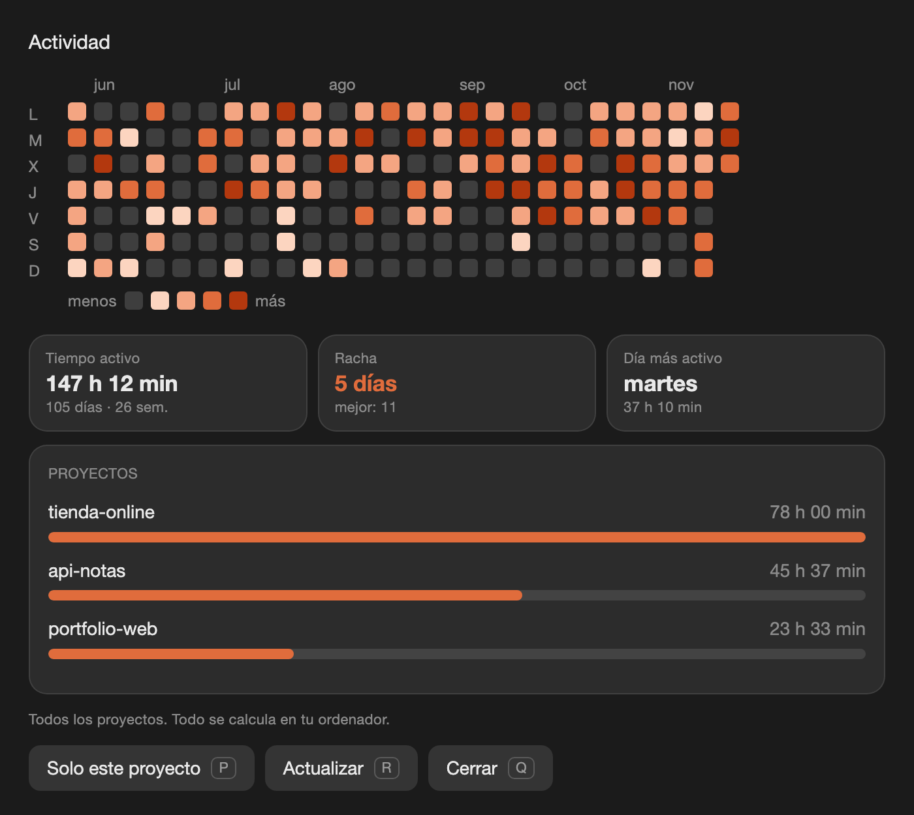
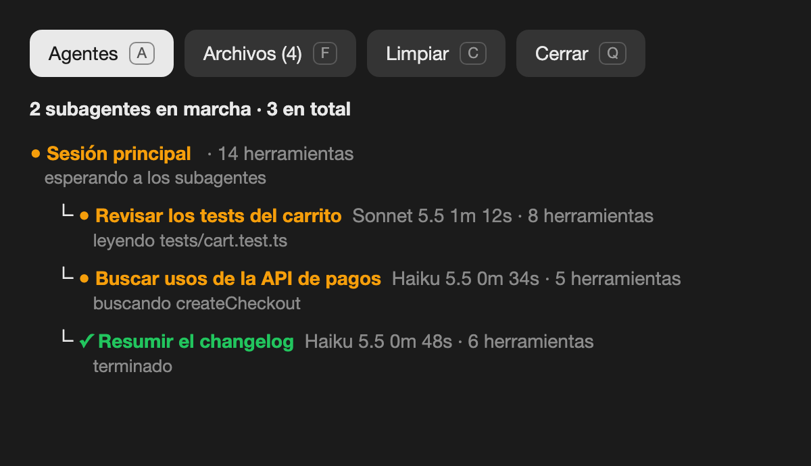

# The mods in detail

[Español](mods.md) | English

Back to the [README](../README.en.md).

Built and tested with Claude Code 2.1.326. Screenshots use sample data. The
panels and rounded bars are designed for the desktop app; in the terminal the mods
work with a simpler version. The interface text of the mods is in Spanish.

| Mod | What it does | Command |
|---|---|---|
| [prompt-band](#prompt-band) | 5h and 7d limits, context and shortcuts above the prompt | |
| [heatmap](#heatmap) | Activity map by day, with streak and time per project | `/heatmap` |
| [agent-radar](#agent-radar) | One line for each running subagent | `/radar` |
| [mission-control](#mission-control) | Subagent tree and the files they touch | `/mission` |
| [modelo-justo](#modelo-justo) | Picks Haiku, Sonnet or Opus for each subagent, with a policy for Opus | `/modelo-justo` |
| [comandos](#comandos) | Per-project command notebook with a copy button | `/comandos` |
| [ramas](#ramas) | Line graph of the repository's branches and commits | `/ramas` |

## prompt-band

A row above the text box with three meters.

- **5h and 7d**: how much of each usage window of your subscription you have
  used, and how long until it resets (`↻ 4h 25m`).
- **ctx**: how full the conversation's context window is.

The meters turn from green to orange at 75% and to red at 90%. Going past 90%
shows a notice, once per window. On the right there is one button for each
installed mod of this collection, which opens or closes its panel.

On the desktop app the bars are pills drawn in SVG; in the terminal they are
text bars. In a narrow window, or with panels open beside it, the countdown is
dropped and the bar uses that space, with the percentage next to it.

Limits arrive with the reply to each message. In a new or resumed session, 5h and
7d show greyed out with a dash until the first reply.

It reads no files and makes no requests: it uses the figures the session already
has. If your account has no subscription limits, only the context is shown.

## heatmap

One square per day with the time you have spent in Claude Code, like GitHub
contributions. Below it, three cards (active time, streak and busiest day) and the
projects with the most time.

- `/heatmap` opens and closes the panel.
- "Solo este proyecto" (only this project) filters by the current folder;
  "Actualizar" (refresh) recalculates.

Active time is the time between messages, ignoring pauses of more than five
minutes. If two sessions run at once, both count.

**Data.** A Python script walks the logs in `~/.claude/projects` and reads only
the time of each message and the project folder name. It does not read the text
of conversations or make network requests. The result is saved in
`~/.claude/heatmap/ledger.json`: Claude Code deletes its logs after a while, and
this way older days do not vanish from the map. It needs `python3`.

## agent-radar

One line above the prompt for each running subagent: description, model, time,
number of tools used and what it is doing now. When one finishes it stays for 30
seconds with a check mark and a notice appears.

`/radar` opens a panel with all the session's subagents; pick one to see its
latest messages.

It only reads what the engine reports about subagents. It calls no model and
makes no requests. For Bash calls it keeps only the program name, never the
command line, so a token typed in it is not stored. It does not follow background
commands.

## mission-control

`/mission` opens a panel with two tabs:

- **Agentes** (agents): the tree of who spawned whom, with what each one is doing
  and how many tools it has used.
- **Archivos** (files): the files read or edited and which agent touched them.

`/mission archivos` opens the second one directly. It only reads what the engine
reports; it calls no model and makes no requests.

## modelo-justo

Picks the model of subagents according to the task.

When Claude launches a subagent without naming a model, it gets Haiku, Sonnet or
Opus based on its short description. A model that is already set, or a fork, is
respected. In `sugerir` (suggest) mode the choice is only noted in the panel's
list.

**Opus.** Since it is the model that costs the most, it has its own policy,
changed in the panel:

- **Permitir** (allow): assigned as is.
- **Avisar** (warn): assigned, and a notice appears. This is the default.
- **Preguntar** (ask): before using Opus a dialog opens with three answers (allow
  Opus, use Sonnet or use Haiku). The subagent waits for your answer with no time
  limit: if you leave Claude working unattended, pick Limitar or Avisar.
- **Limitar** (limit): Opus is never used for subagents; Sonnet is the ceiling.

`/modelo-justo` opens a panel to turn it on, choose the mode, choose the Opus
policy and see the latest picks. `on`, `off`, `auto`, `sugerir`,
`opus permitir|avisar|preguntar|limitar` and `lista` also work. The state is
remembered between sessions.

**What is sent.** Classification is a call to a small model through your session's
client. Only the short description of the subagent is sent, never the task text
or your messages. With `/modelo-justo off` no call is made.

**Known limit.** A plugin cannot change the model of the main conversation, only
that of subagents. That is why this mod does not act on your messages.

## comandos

`/comandos` opens a panel with the saved commands of the current project. Each
note has a title, the command below it and a button to copy it.

To add one, type the title, press Enter, type the command and press Enter. Each
project has its own notes, saved locally. It calls no model and makes no
requests.

## ramas

`/ramas` opens a panel with the line graph of the session's repository: one dot
per commit, one colored line per branch, and the branch names and tags above each
commit. Merge commits have a hollow dot and the current branch is filled.

It shows the latest 60 commits across all branches, and a button switches to the
current branch only. If the local branch and the remote one match, a single label
is shown.

By default it reads the repository of the session's folder. `/ramas path` adds
another repository (it accepts `~`) and opens it; the "Otro repo" (next repo)
button cycles through the ones you have added, "Quitar" (remove) forgets the
current one, and `/ramas sesion` goes back to the session's. Paths are saved
locally.

It only reads `git log` locally, does not modify the repository, calls no model
and makes no requests.
