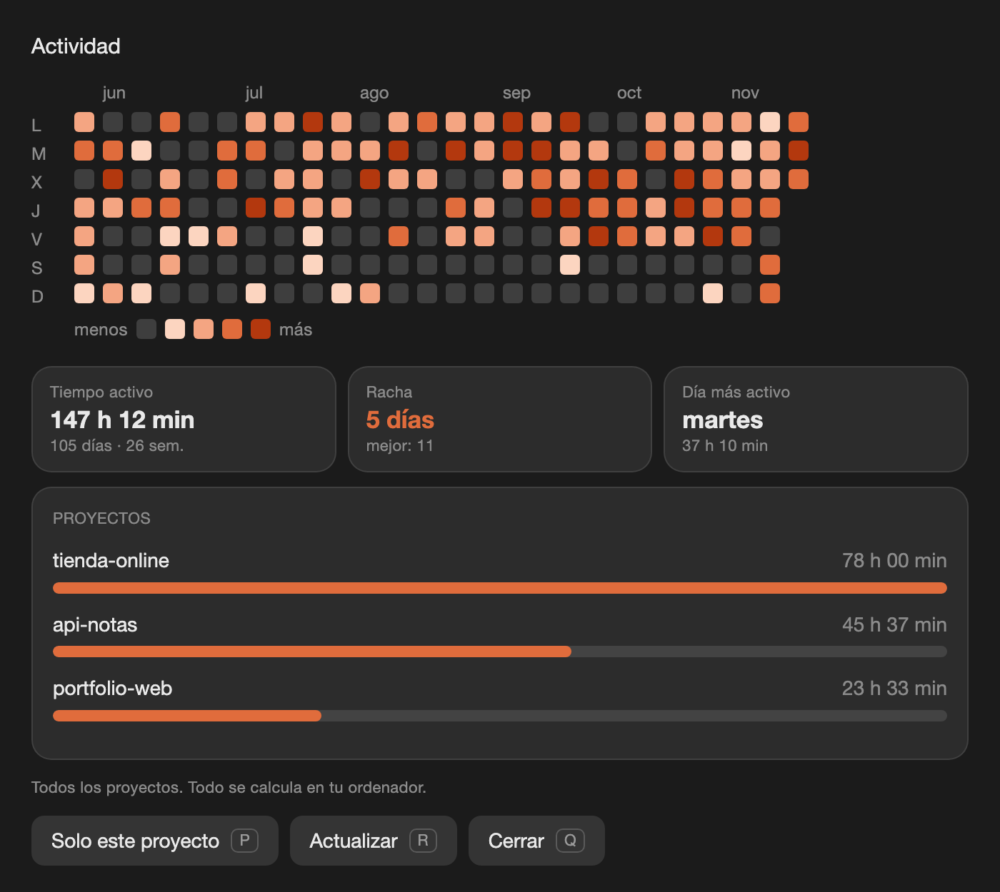
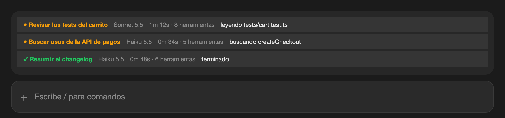
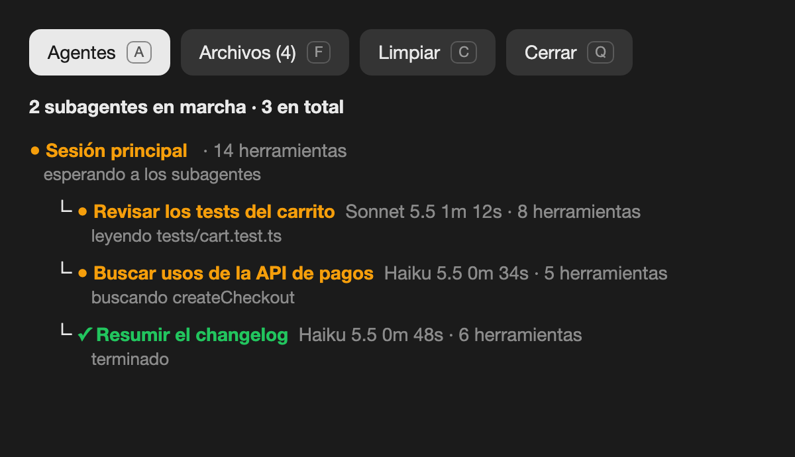
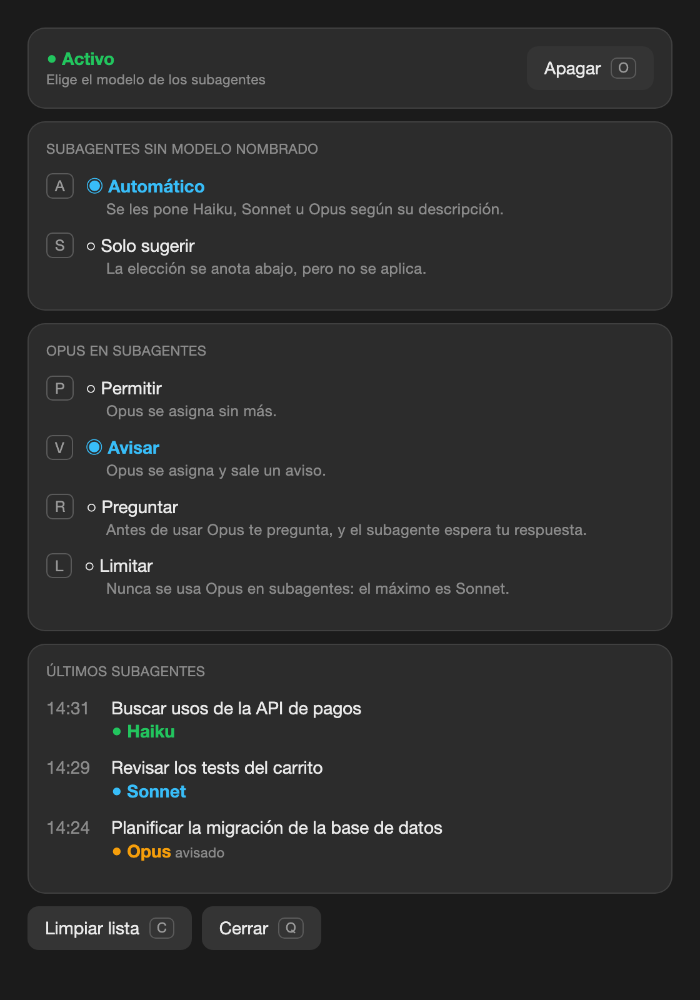
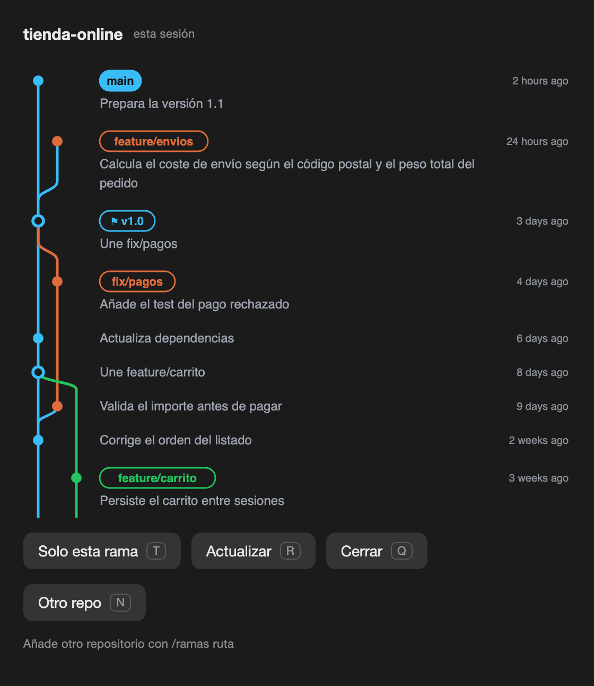

# Los mods en detalle

Español | [English](mods.en.md)

Volver al [README](../README.md).

Desarrollados y probados con Claude Code 2.1.326. Las imágenes usan datos de ejemplo. Los paneles y las barras
redondeadas están pensados para la app de escritorio; en la terminal los mods
funcionan con una versión más sencilla.

| Mod | Qué hace | Comando |
|---|---|---|
| [prompt-band](#prompt-band) | Límites de 5h y 7d, contexto y atajos sobre el prompt | |
| [heatmap](#heatmap) | Mapa de actividad por días, con racha y tiempo por proyecto | `/heatmap` |
| [agent-radar](#agent-radar) | Una línea por cada subagente en marcha | `/radar` |
| [mission-control](#mission-control) | Árbol de subagentes y archivos que tocan | `/mission` |
| [modelo-justo](#modelo-justo) | Elige Haiku, Sonnet u Opus para cada subagente, con política para Opus | `/modelo-justo` |
| [comandos](#comandos) | Bloc de notas de comandos por proyecto, con botón de copiar | `/comandos` |
| [ramas](#ramas) | Gráfico de líneas con las ramas y commits del repositorio | `/ramas` |

## prompt-band

Una fila encima de la barra de escritura con tres medidores.

- **5h y 7d**: lo que llevas gastado de cada ventana de uso de tu suscripción y
  cuánto falta para que se reinicie (`↻ 4h 25m`).
- **ctx**: lo llena que está la ventana de contexto de la conversación.

Los medidores pasan de verde a naranja al 75% y a rojo al 90%. Al superar el 90%
sale un aviso, una sola vez por ventana. A la derecha hay un botón por cada mod
instalado de esta colección, que abre o cierra su panel.

En la app de escritorio las barras son píldoras dibujadas en SVG; en la terminal,
barras de texto. En una ventana estrecha, o con paneles abiertos al lado, se quita
la cuenta atrás y la barra aprovecha ese espacio, con el porcentaje a su lado.

Los límites llegan con la respuesta de cada mensaje. En una sesión nueva o
reanudada, 5h y 7d salen apagados con un guion hasta la primera respuesta.

No lee archivos ni hace peticiones: usa las cifras que la sesión ya tiene. Si tu
cuenta no tiene límites de suscripción, solo se muestra el contexto.

## heatmap

Un cuadro por día con el tiempo que has pasado en Claude Code, como las
contribuciones de GitHub. Debajo, tres tarjetas (tiempo activo, racha y día más
activo) y los proyectos con más tiempo.

- `/heatmap` abre y cierra el panel.
- «Solo este proyecto» filtra por la carpeta actual; «Actualizar» recalcula.

El tiempo activo es el que hay entre mensajes, descartando pausas de más de cinco
minutos. Si dos sesiones corren a la vez, ambas suman.

**Datos.** Un script de Python recorre los logs de `~/.claude/projects` y lee solo
la hora de cada mensaje y el nombre de la carpeta del proyecto. No lee el texto de
las conversaciones ni hace peticiones de red. El resultado se guarda en
`~/.claude/heatmap/ledger.json`: Claude Code borra sus logs pasado un tiempo, y
así los días antiguos no desaparecen del mapa. Necesita `python3`.

## agent-radar

Una línea encima del prompt por cada subagente en marcha: descripción, modelo,
tiempo, número de herramientas usadas y lo que hace ahora. Al terminar se queda 30
segundos con una marca y sale un aviso.

`/radar` abre un panel con todos los subagentes de la sesión; al pulsar uno ves
sus últimos mensajes.

Solo lee lo que el motor informa sobre los subagentes. No llama a ningún modelo ni
hace peticiones. De las llamadas a Bash guarda únicamente el nombre del programa,
no la línea de comandos, para que un token escrito en ella no se almacene. No
sigue comandos en segundo plano.

## mission-control

`/mission` abre un panel con dos pestañas:

- **Agentes**: el árbol de quién lanzó a quién, con lo que hace cada uno y cuántas
  herramientas lleva.
- **Archivos**: los archivos leídos o editados y qué agente los tocó.

`/mission archivos` abre directamente la segunda. Solo lee lo que el motor
informa; no llama a ningún modelo ni hace peticiones.

## modelo-justo

Elige el modelo de los subagentes según la tarea.

Cuando Claude lanza un subagente sin nombrar modelo, se le asigna Haiku, Sonnet u
Opus a partir de su descripción corta. Un modelo ya indicado, o un fork, se
respeta. En modo `sugerir` la elección solo se anota en la lista del panel.

**Opus.** Como es el modelo que más gasta, tiene una política propia, que se
cambia en el panel:

- **Permitir**: se asigna sin más.
- **Avisar**: se asigna y sale un aviso. Es la opción por defecto.
- **Preguntar**: antes de usar Opus se abre un diálogo con tres respuestas (permitir
  Opus, usar Sonnet o usar Haiku). El subagente espera tu respuesta, sin tiempo
  máximo: si dejas a Claude trabajando sin supervisión, elige Limitar o Avisar.
- **Limitar**: nunca se usa Opus en subagentes; el máximo es Sonnet.

`/modelo-justo` abre un panel para activarlo, elegir el modo, elegir la política de
Opus y ver las últimas elecciones. También funcionan `on`, `off`, `auto`,
`sugerir`, `opus permitir|avisar|preguntar|limitar` y `lista`. El estado se
recuerda entre sesiones.

**Qué se envía.** La clasificación es una llamada a un modelo pequeño a través del
cliente de tu sesión. Se envía solo la descripción corta del subagente, nunca el
texto de la tarea ni tus mensajes. Con `/modelo-justo off` no se hace ninguna
llamada.

**Límite conocido.** Un plugin no puede cambiar el modelo de la conversación
principal, solo el de los subagentes. Por eso este mod no actúa sobre tus mensajes.

## comandos

`/comandos` abre un panel con los comandos guardados del proyecto actual. Cada
nota tiene un título, el comando debajo y un botón para copiarlo.

Para añadir uno, escribe el título, pulsa Enter, escribe el comando y pulsa
Enter. Cada proyecto tiene sus notas, guardadas en local. No llama a ningún
modelo ni hace peticiones.

## ramas

`/ramas` abre un panel con el gráfico de líneas del repositorio de la sesión:
un punto por commit, una línea de color por rama y los nombres de rama y
etiquetas sobre cada commit. Los commits de fusión llevan el punto hueco y la
rama actual va rellena.

Muestra los últimos 60 commits de todas las ramas, y un botón cambia a solo la
rama actual. Si la rama local y la del servidor coinciden, sale una sola
etiqueta.

Por defecto lee el repositorio de la carpeta de la sesión. `/ramas ruta` añade
otro repositorio (acepta `~`) y lo abre; el botón «Otro repo» recorre los que
has añadido, «Quitar» olvida el actual y `/ramas sesion` vuelve al de la
sesión. Las rutas se guardan en local.

Solo lee `git log` en local, no modifica el repositorio, no llama a ningún
modelo ni hace peticiones.
