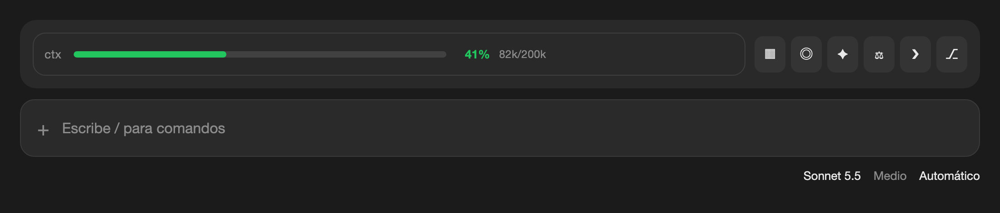

# prompt-band

[Español](README.md) | English

A row above the text box with meters and shortcuts to the other mods.

## What it shows

- **5h and 7d**: how much of each usage window you have used and how long until it
  resets (`↻ 4h 25m`).
- **ctx**: how full the context window is, with the tokens used and the model's
  window (`82k/200k`).
- **Shortcuts**: one button for each mod of this collection that you have
  installed (`heatmap`, `agent-radar`, `mission-control`, `modelo-justo`,
  `comandos` and `ramas`). They open or close their panel.

## With and without limits

The mod adapts on its own, with nothing to choose at install time:

- **Subscription account**: 5h and 7d are shown with the countdown, plus the
  context. If one is missing between readings, its card is greyed out with a dash.
- **Account without limits** (API key, Bedrock, Vertex, a gateway or a company
  account): only the context is shown. The 5h and 7d cards do not appear, instead
  of sitting empty forever.

As soon as the account reports limits for the first time, 5h and 7d switch on.

## How it behaves

- The context turns orange at 65% and red at 80%, with a notice once, since it
  auto-compacts well before 100%. 5h and 7d do so at 75% and 90%.
- Limits arrive with the reply to each message, and the last known reading is
  kept.
- When space is tight, for example with panels open beside it, the countdown is
  dropped and the bar uses that room.
- On the desktop app the bars are pills drawn in SVG. In the terminal they are
  text bars.

## Privacy

It uses only the figures the session already knows. It reads no files and makes
no requests.
