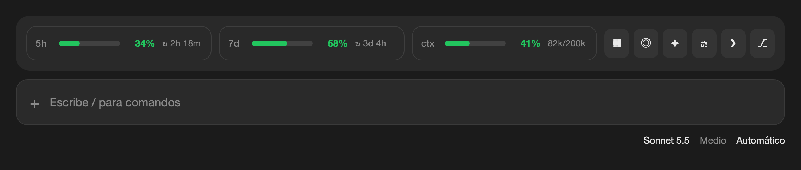
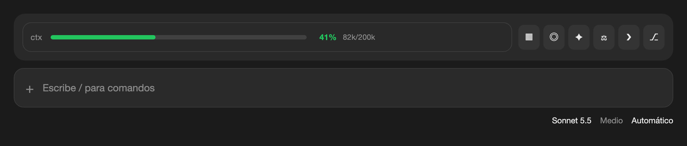

# prompt-band

Español | [English](README.en.md)

Una fila encima de la barra de escritura con medidores y atajos a los demás mods.

## Qué muestra

- **5h y 7d**: lo que llevas gastado de cada ventana de uso y cuánto falta para
  que se reinicie (`↻ 4h 25m`).
- **ctx**: lo llena que está la ventana de contexto, con los tokens usados y la
  ventana del modelo (`82k/200k`).
- **Atajos**: un botón por cada mod de esta colección que tengas instalado
  (`heatmap`, `agent-radar`, `mission-control`, `modelo-justo`, `comandos` y
  `ramas`). Abren o cierran su panel.

## Con y sin límites

El mod se adapta solo, sin que tengas que elegir nada al instalarlo:

- **Cuenta con suscripción**: salen 5h y 7d con la cuenta atrás, más el contexto.
  Si entre lecturas falta alguna, la tarjeta queda apagada con un guion.
- **Cuenta sin límites** (clave de API, Bedrock, Vertex, un gateway o una cuenta
  de empresa): solo sale el contexto. Las tarjetas 5h y 7d no aparecen, en lugar
  de quedarse vacías para siempre.

En cuanto la cuenta informa de límites por primera vez, 5h y 7d se activan.

## Cómo se comporta

- El contexto pasa a naranja al 65% y a rojo al 80%, con un aviso una sola vez,
  porque se compacta solo mucho antes de llegar al 100%. 5h y 7d lo hacen al 75% y
  al 90%.
- Los límites llegan con la respuesta de cada mensaje, y se conserva la última
  lectura conocida.
- Si el espacio es justo, por ejemplo con paneles abiertos al lado, se quita la
  cuenta atrás y la barra aprovecha ese sitio.
- En la app de escritorio las barras son píldoras dibujadas en SVG. En la
  terminal son barras de texto.

## Privacidad

Usa solo las cifras que la sesión ya conoce. No lee archivos ni hace peticiones.
